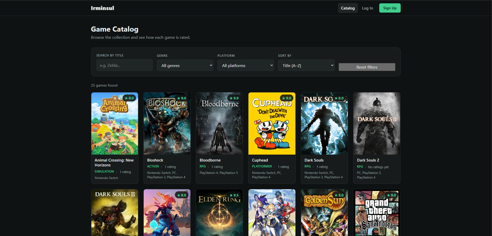
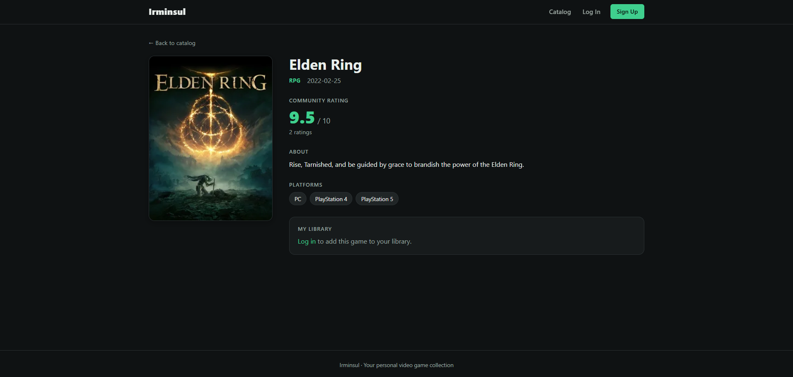
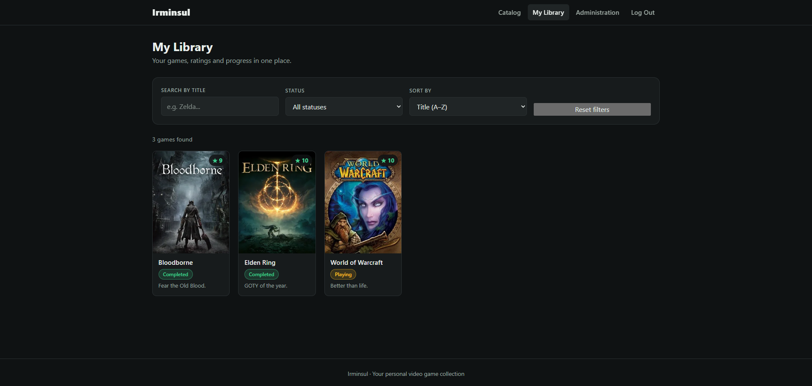
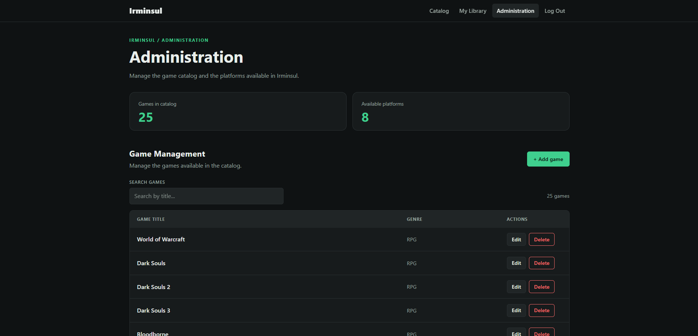

# Irminsul

A full-stack application for managing and rating a personal video game collection.

[](https://github.com/AlexLillo/Irminsul/actions/workflows/ci.yml)


Browse a shared catalog of games, keep your own library with a status, a rating
and personal notes, and see how the community rates each title. Administrators
manage the catalog and the platforms.

## Screenshots

| Catalog | Game detail |
|---|---|
|  |  |

| My library | Administration |
|---|---|
|  |  |

## Features

- **Public catalog** with search, genre and platform filters, and sorting by
  title, rating or release date.
- **Game detail** page with the community average rating and the number of
  ratings.
- **Personal library**: track each game as *Backlog*, *Playing*, *Completed* or
  *Dropped*, give it a 1-10 rating and add notes.
- **Accounts**: registration and login with automatic sign-in after sign-up.
- **Role-based access**: regular users manage their own library; administrators
  manage games and platforms.
- **Admin panel**: create, edit and delete games and platforms, with validation
  and clear conflict errors (for example, a game that is already in someone's
  library cannot be deleted).
- **Dark theme** UI with a cover-first grid and a fallback image for missing or
  broken covers.

## Tech stack

| Layer | Technologies |
|---|---|
| Backend | Java 21, Spring Boot 4, Spring Web, Spring Security, Spring Data JPA / Hibernate, Bean Validation, Maven |
| Database | PostgreSQL 16 (Docker Compose) |
| Frontend | Angular 22 (standalone components, signals), TypeScript, HTML/CSS, Vitest |
| Testing | JUnit 5, Mockito, MockMvc, Spring Security Test |
| Tooling | Git, GitHub Actions, Docker Compose, Postman |

## Architecture

```
 Angular SPA (:4200)  ──── REST / JSON ────▶  Spring Boot API (:8080)  ──── JPA ────▶  PostgreSQL (:5432)
 signals, route guards,                       controllers → services → repositories
 HTTP interceptor                             session auth + CSRF cookie, BCrypt, roles
```

- The API is layered: controllers handle HTTP, services hold the business rules
  and repositories talk to the database. Entities are never exposed directly;
  requests and responses use DTOs.
- Authentication uses a server-side session (`JSESSIONID`) plus a CSRF token in
  the `XSRF-TOKEN` cookie, sent back by the SPA in the `X-XSRF-TOKEN` header.
  Passwords are hashed with BCrypt.
- A global exception handler maps validation errors, missing resources and
  conflicts to consistent `400`, `404` and `409` responses.

## Getting started

### Prerequisites

- Git
- Java 21 (`java -version`)
- Node.js 24 and npm
- Docker, running (`docker --version`)

### 1. Clone the repository

```bash
git clone https://github.com/AlexLillo/Irminsul.git
cd Irminsul
```

### 2. Start the database

```bash
docker compose up -d
```

The `-d` flag runs PostgreSQL in the background, so you can keep using the
same terminal.

### 3. Start the backend

```bash
cd backend
./mvnw spring-boot:run        # Windows: mvnw.cmd spring-boot:run
```

Wait until the log shows that the application has started on port 8080. The API
is then available at `http://localhost:8080`. On the first run, with an empty
database, demo data is created automatically (see below). Leave this terminal
open.

### 4. Start the frontend

In a second terminal, from the repository root:

```bash
cd frontend
npm install
npm start
```

Open `http://localhost:4200`. Leave this terminal open too.

### Stopping

Press `Ctrl+C` in the backend and frontend terminals. To stop the database, run
`docker compose down`. Add `-v` to also delete its data; the demo data is
created again the next time the backend starts.

### Troubleshooting

- **Port 5432 is already in use** (another PostgreSQL is running): set
  `DB_PORT` to a free port in a `.env` file next to `docker-compose.yml`, and
  export the same `DB_PORT` before starting the backend.
- **The backend cannot connect to the database**: check that the container is
  running with `docker compose ps`.
- **`./mvnw: Permission denied`** (Linux/macOS): run `chmod +x backend/mvnw`.

### Demo accounts

When the database is empty, the application creates sample platforms, games,
users and ratings. These accounts are for demonstration only:

| Role | Username | Password |
|---|---|---|
| Administrator | `alex` | `alex12345` |
| User | `andrea` | `andrea12345` |

The other demo users follow the same pattern (`<username>12345`).

> **Do not expose an instance with demo data to the Internet.** Set
> `SEED_DATA=false` to disable it.

### Configuration

The backend reads these environment variables (all have local defaults):

| Variable | Default | Description |
|---|---|---|
| `DB_HOST` | `localhost` | Database host |
| `DB_PORT` | `5432` | Database port |
| `DB_NAME` | `irminsul` | Database name |
| `DB_USER` | `postgres` | Database user |
| `DB_PASSWORD` | `postgres` | Database password |
| `SEED_DATA` | `true` | Create demo data on first startup |

`.env.example` documents the database values. Docker Compose reads a `.env`
file placed next to `docker-compose.yml`, but the backend does **not** read it:
if you change the values there, set the same environment variables when you
start the backend (or in your IDE run configuration).

## Running the tests

```bash
# Backend
cd backend
./mvnw test

# Frontend
cd frontend
npm test
```

What is covered:

- **Services**: business rules and error cases, with Mockito (duplicates,
  conflicts, not found, alphabetical ordering of platforms, email
  normalization).
- **Controllers**: request validation and HTTP status codes, using `@WebMvcTest`.
- **Security rules**: a dedicated test runs the real filter chain and checks
  which endpoints are public, which need a session, which are admin-only, and
  that unsafe requests without a CSRF token are rejected (`401` / `403`).
- **Frontend**: route guards, the authentication service and the catalog
  filtering and sorting logic.

The tests run automatically on every push to `main` and on every pull request
through GitHub Actions.

## API overview

All state-changing requests (`POST`, `PUT`, `DELETE`) must include the
`X-XSRF-TOKEN` header. Request the token first with `GET /api/auth/csrf`.

| Method | Endpoint | Access | Description |
|---|---|---|---|
| `GET` | `/api/auth/csrf` | Public | Issues the CSRF token |
| `POST` | `/api/auth/login` | Public | Starts a session |
| `POST` | `/api/auth/logout` | Public | Ends the session |
| `POST` | `/api/users` | Public | Registers a new user |
| `GET` | `/api/users/me` | Authenticated | Current user |
| `GET` | `/api/users`, `/api/users/{id}` | Admin | User administration |
| `GET` | `/api/games`, `/api/games/{id}` | Public | Catalog, with average rating and rating count |
| `POST` `PUT` `DELETE` | `/api/games`, `/api/games/{id}` | Admin | Manage games |
| `GET` | `/api/platforms`, `/api/platforms/{id}` | Authenticated | Platforms, sorted by name |
| `POST` `PUT` `DELETE` | `/api/platforms`, `/api/platforms/{id}` | Admin | Manage platforms |
| `GET` | `/api/user-games/me` | Authenticated | My library |
| `GET` `PUT` `DELETE` | `/api/user-games/{gameId}` | Authenticated | One game of my library |
| `POST` | `/api/user-games` | Authenticated | Add a game to my library |
| `GET` | `/api/user-games`, `/api/user-games/user/{userId}` | Admin | Libraries of all users |

## Design decisions

- **Session + CSRF instead of JWT.** The SPA and the API are meant to be served
  from the same origin, so an HttpOnly session cookie (not readable from
  JavaScript) plus a CSRF token is a simple and safe fit. The trade-off is that
  the API is not stateless.
- **Conflicts are explicit.** Deleting a game or a platform that is in use
  returns `409 Conflict` with a clear message instead of a database error.
- **Rating statistics are calculated in the database** with aggregate queries,
  not in memory.
- **Covers are external links.** The app stores only the URL; if an image is
  missing or fails to load, a placeholder is shown.
- **No profile management, on purpose.** The first version focuses on the
  library itself; editing or deleting accounts is out of scope.
- **Normalized input.** Emails are stored in lowercase and usernames and emails
  are unique.

## Production considerations

The project is built to run locally. Before deploying it, I would change:

- **Secrets and demo data**: strong database credentials through environment
  variables and `SEED_DATA=false`. Without demo data there is no administrator,
  so the first one is promoted manually
  (`UPDATE users SET role = 'ADMIN' WHERE username = '...'`) or created at
  startup from environment variables.
- **Same origin for the SPA and the API**: serve both behind a reverse proxy
  (for example `/` for the Angular build and `/api` for Spring). This avoids
  CORS and cross-site cookie problems, because the CSRF cookie must be readable
  by the SPA.
- **Configuration**: the API URL is hard-coded in the frontend and the allowed
  CORS origin in `SecurityConfig`; both should come from configuration.
- **HTTPS**: mark the session cookie as `Secure`
  (`server.servlet.session.cookie.secure=true`) and set
  `server.forward-headers-strategy=framework` behind a proxy.
- **Database schema**: replace `ddl-auto=update` with versioned migrations
  (Flyway or Liquibase).

## Roadmap

- Repository tests against a real PostgreSQL with Testcontainers, and
  re-enabling the full application context test.
- Flyway migrations.
- OpenAPI / Swagger documentation.
- Server-side pagination and filtering.
- Dockerfiles and a single `docker compose up` for the whole stack.
- Redirect to the login page when the session expires while using the app.

## License

Distributed under the MIT License. See [LICENSE](LICENSE).
